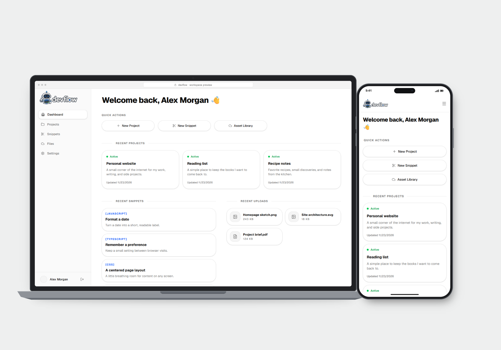
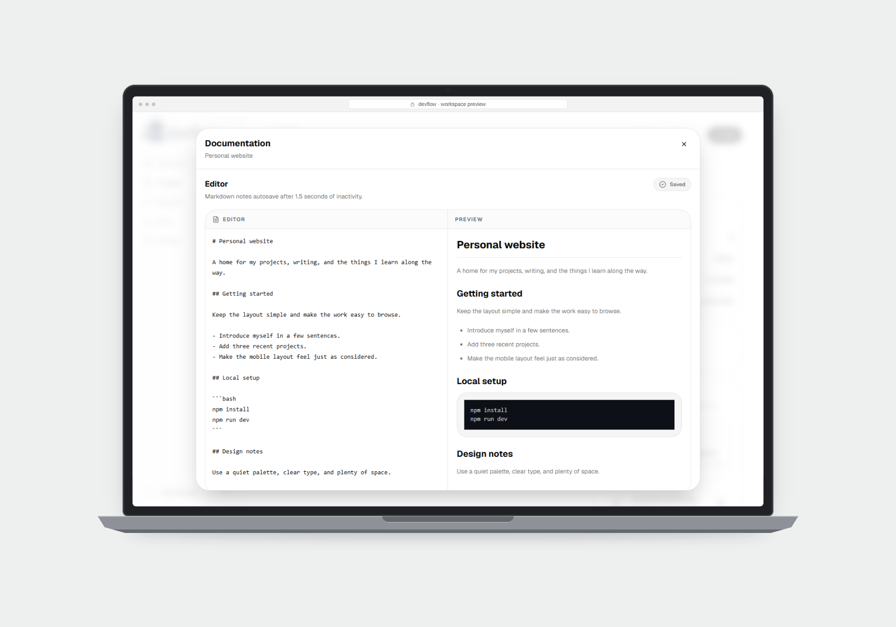
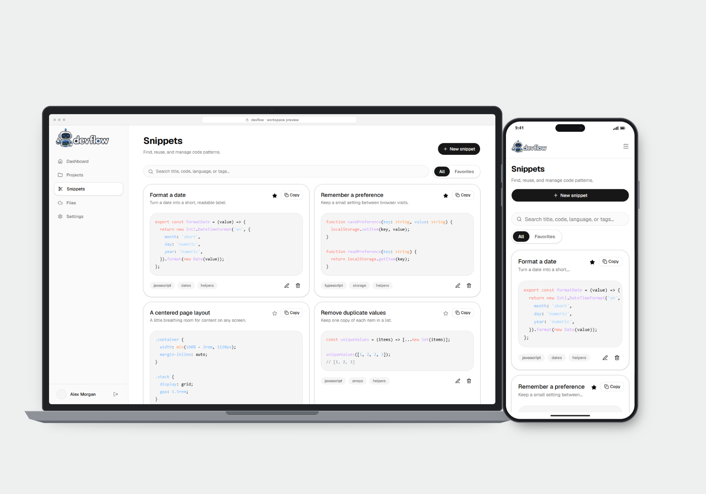



  

<h1 align="center">A place for your work.</h1>

  Keep your projects, notes, code snippets, and files together. 
  A personal workspace for the things you’re building.

  <a href="https://devflow-five-iota.vercel.app">Try DevFlow</a>
  &nbsp;·&nbsp;
  <a href="client/src/assets/device-mockups">Browse screenshots</a>

<picture>
  <source media="(prefers-color-scheme: dark)" srcset="client/src/assets/device-mockups/paired/dark/dashboard.png" />
  
</picture>

## Everything has its place

DevFlow is for developers juggling personal projects, side ideas, and the little details that go with them. Give each project a home and keep useful work easy to find.

- **Projects:** Keep a description, useful links, tags, and cover image together. Mark projects as active, paused, or archived.
- **Notes:** Write project documentation with a live preview and automatic saving.
- **Snippets:** Save code you’ll use again. Search it, tag it, favorite it, and copy it when you need it.
- **Files:** Store screenshots, diagrams, and PDFs alongside their projects. Browse them together in the file library.
- **Your workspace:** See recent work at a glance, update your profile, and choose a light or dark appearance.

Sign up with email, Google, or GitHub. Your workspace is personal, and the layout adapts to desktop and mobile.

## Keep the details close

Setup notes, project decisions, and reminders stay with the work they belong to. Write on one side and see the finished page on the other.

<picture>
  <source media="(prefers-color-scheme: dark)" srcset="client/src/assets/device-mockups/desktop/dark/project-documentation.png" />
  
</picture>

## Good code is worth keeping

Build a collection of useful snippets instead of searching through old projects. Add a description and a few tags so the right piece is easy to find again.

<picture>
  <source media="(prefers-color-scheme: dark)" srcset="client/src/assets/device-mockups/paired/dark/snippets.png" />
  
</picture>

*Screenshots use sample data. Light and dark versions, plus more page previews, are available in the [screenshot gallery](client/src/assets/device-mockups).*

---

[Open DevFlow](https://devflow-five-iota.vercel.app)
